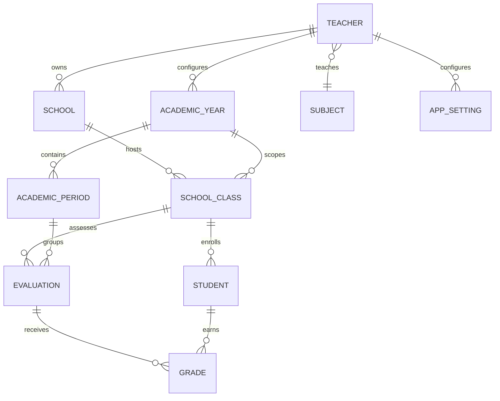

# EduNote — architecture V1

## Synthèse fonctionnelle

EduNote est une application Flutter locale destinée à un enseignant principal par installation. Elle organise les établissements, années et périodes scolaires, classes, élèves, matières, évaluations et notes. Elle calcule les moyennes sans remplacer les notes absentes par zéro et permet d’exporter des relevés PDF/XLSX ainsi qu’une sauvegarde chiffrée restaurable. Aucune connexion réseau n’est nécessaire au fonctionnement métier.

## Décisions d’architecture

- Flutter/Dart, Material 3 et navigation principale à cinq sections.
- Architecture Clean, organisée par fonctionnalité : `presentation` → Use Cases du `domain` → contrats de repository → implémentations `data` → Drift/SQLite.
- `StatefulWidget` et `setState()` pour l’état local des écrans. GetIt compose les dépendances ; il ne gère pas l’état d’interface.
- Drift est l’unique accès relationnel aux données. Les modèles Drift restent dans `data`; les entités du domaine sont indépendantes.
- Les opérations composées (création/suppression avec dépendances, saisie en lot, restauration) utilisent des transactions.
- Les identifiants sont des UUID générés côté client. Dates stockées en UTC au format SQLite déterministe.
- Suppressions en cascade seulement dans les agrégats maîtrisés et toujours exécutées dans une transaction après confirmation UI.

## Structure cible

```text
lib/
  app/                 # MaterialApp, navigation, route guards
  core/
    database/          # Drift, tables, DAOs, migrations
    errors/ security/ services/ theme/ utils/ widgets/
  features/
    authentication/ dashboard/ schools/ academic_years/ classes/
    students/ subjects/ evaluations/ grades/ results/ exports/
    backups/ settings/ profile/
  injection_container.dart
  main.dart
test/
  features/ core/
```

Chaque feature possède au besoin `data/{datasources,models,repositories}`, `domain/{entities,repositories,usecases}` et `presentation/{pages,widgets}`. Les règles de calcul résident dans `features/results/domain`, jamais dans un widget ou une requête SQL.

## Modèle relationnel



### Tables Drift / contraintes clés

| Table | Champs principaux | Contraintes et intégrité |
| --- | --- | --- |
| `teachers` | id, prénom, nom, profession, `subjectId`, WhatsApp, hash/sel/paramètres, timestamps | Une seule ligne de compte ; une matière requise à l’inscription ; `subjectId` reste nullable pour résoudre les profils historiques |
| `schools` | id, teacherId, nom, type, ville, adresse, timestamps | FK enseignant ; index teacherId |
| `academic_years` | id, teacherId, label, dates, isActive | `UNIQUE(teacherId,label)`, dates cohérentes ; au plus une année active par enseignant |
| `academic_periods` | id, academicYearId, nom, dates | FK année, `UNIQUE(academicYearId,name)` |
| `school_classes` | id, schoolId, academicYearId, nom, niveau, timestamps | FKs école/année, `UNIQUE(schoolId,academicYearId,name)` |
| `students` | id, classId, prénom, nom, sexe, naissance, matricule, ordre, timestamps | FK classe ; matricule unique dans la classe lorsqu’il existe ; index classe/nom |
| Catalogue `subjects` | id, `teacherId`, nom, timestamps | Le profil enseignant référence une seule matière |
| `class_subjects` (compatibilité) | id, `classId`, `subjectId` | Conservé pour lire les évaluations historiques ; les nouvelles classes reçoivent uniquement la matière du profil |
| `evaluations` | id, `classSubjectId`, `periodId`, type, numéro, titre, date, barème, timestamps | Référence de compatibilité vers la classe ; création contrôlée contre la matière du profil et l’année ; devoirs vérifiés par classe/période |
| `grades` | id, evaluationId, studentId, score nullable, status, timestamps | `UNIQUE(evaluationId,studentId)` ; status note/absent/non renseigné ; score nullable, bornes contrôlées par use case |
| `app_settings` | clé, valeur | Valeurs versionnées, aucune donnée sensible en clair |

SQLite active `PRAGMA foreign_keys = ON`. Une note est acceptée uniquement si l’élève appartient à la classe de l’évaluation, si cette classe appartient à l’établissement actif et si période/année correspondent à la classe. Cette vérification est faite dans le repository/use case transactionnel ; des contraintes/index uniques renforcent les invariants locaux. Les changements de schéma passent par des migrations Drift versionnées. Les opérations d’import vérifient aussi les relations avant commit.

Le schéma est en version 2 : `Teachers.subjectId` a été ajouté nullable afin de ne pas inventer la matière des comptes existants. `ClassSubjects` et `Evaluation.classSubjectId` restent un pont de compatibilité ; la migration complète des évaluations vers `Evaluation.classId` n’est pas encore faite. Les profils historiques sans matière ne peuvent être résolus que si leurs évaluations désignent une matière unique ; les historiques ambigus sont bloqués explicitement.

## Use Cases principaux

- `CreateLocalAccount`, `UnlockLocalAccount`, `LockSession`, `UpdateTeacherProfile`.
- `CreateSchool`, `UpdateSchool`, `DeleteSchoolWithConfirmation`.
- `CreateAcademicYear`, `SetActiveAcademicYear`, `ManageAcademicPeriods`.
- `CreateClass`, `MoveOrDeleteClass`, `ListClassesForSchoolYear`.
- `CreateStudent`, `UpdateStudent`, `SearchStudents`, `GetStudentReport`.
- `ChooseTeacherSubject`, `ChangeTeacherSubjectBeforeFirstEvaluation`.
- `ChooseTeacherSubject`, `ChangeTeacherSubjectBeforeFirstEvaluation` (implémentés via `SetTeacherSubject`).
- `CreateEvaluation`, `SaveGradesBatch`, `UpdateGrade`, `DeleteGrade`.
- `CalculateStudentSubjectResult`, `GetClassResults`, `GetClassStatistics`.
- `ExportResultsPdf`, `ExportResultsXlsx`, `ShareExport`.
- `CreateEncryptedBackup`, `ValidateBackup`, `RestoreBackupAtomically`, `EraseLocalData`.

Les Use Cases retournent des résultats typés/erreurs de domaine. Les pages traduisent ces erreurs en messages français compréhensibles et gardent les saisies en mémoire en cas d’échec.

## Écrans et navigation

1. **Onboarding** (3 pages, indicateurs, passer/commencer), affiché une seule fois.
2. **Inscription / Connexion** : profil enseignant, numéro au format international, profession personnalisée, validation locale, verrouillage après tentatives répétées.
3. **Accueil** : état vide exact demandé quand aucune école ; sinon compteurs calculés depuis SQLite, activités et raccourcis.
4. **Établissements** : liste, détail, classes, formulaires ajout/modification, confirmation de suppression avec conséquences.
5. **Année et classes** : sélection année/période, liste et formulaire de classes.
6. **Classe / élèves** : recherche, tri, ajout/modification, profil élève ; affichage de la matière unique du profil.
7. **Matière du profil** : choix unique à l’inscription, modifiable uniquement avant la première évaluation.
8. **Évaluations** : filtres école/classe/année/période, matière héritée du profil, création interrogation/devoir, saisie en lot et gestion explicite des absences.
9. **Résultats** : tableau horizontal à colonnes d’interrogations dynamiques, résultats individuels et statistiques sur résultats complets.
10. **Export** : choix des filtres, prévisualisation/impression/partage PDF et export XLSX.
11. **Profil / paramètres** : profil, sécurité locale, sauvegarde/restauration et suppression complète.

La barre principale expose Accueil, Établissements, Évaluations, Résultats et Profil. Les écrans détaillés sont poussés depuis ces sections. Un garde de route affiche l’onboarding, l’inscription ou le verrouillage selon l’état local.

## Parcours utilisateur

Première ouverture → onboarding → inscription avec choix de l’unique matière → création d’une année/période active → ajout d’un établissement → classe → élèves → évaluations → saisie des notes → consultation des moyennes → export ou sauvegarde. Aux ouvertures suivantes, l’application demande le déverrouillage selon la préférence de session. La restauration passe par sélection du fichier, validation et déchiffrement dans une base temporaire, puis remplacement transactionnel.

## Règles de calcul
## État de livraison

Le profil mono-matière, le verrouillage local, la sauvegarde transactionnelle des notes et les contrôles d’appartenance école/classe sont implémentés et testés. Les sections Évaluations et Résultats de la navigation principale restent des placeholders ; les flux accessibles depuis une classe sont fonctionnels. PDF, XLSX, sauvegarde/restauration chiffrée, suppression globale et migration complète hors `ClassSubject` restent à réaliser.

## Règles de calcul

Chaque note renseignée est normalisée sur 20 : `score / maxScore * 20`. Une absence et une valeur manquante sont exclues du calcul et restent visibles avec leur statut. La moyenne d’interrogations est la moyenne arithmétique des notes normalisées disponibles ; sans interrogation renseignée, elle est indisponible. La moyenne de matière n’est complète que si au moins une interrogation est disponible et que Devoir 1 et Devoir 2 ont une note. Alors `(moyenne interrogations + devoir1 + devoir2) / 3`. Les résultats intermédiaires ne sont pas arrondis ; l’affichage arrondit à deux décimales. Un zéro explicite compte comme note. Les statistiques de classe incluent uniquement les moyennes finales complètes. Ces règles seront centralisées et couvertes par les cas de test listés dans le brief.

## PDF et XLSX

L’export lit un instantané cohérent des résultats filtrés et inclut les métadonnées école/classe/matière/période/année/enseignant/date. PDF paginé, orientation paysage si le nombre de colonnes le requiert ; XLSX avec cellules numériques pour les notes présentes et cellules vides pour les statuts sans note. Les fichiers sont des copies indépendantes partagées via les mécanismes natifs.

## Sauvegarde et sécurité

Le fichier de sauvegarde est un conteneur versionné comprenant un payload JSON canonique et un manifeste d’intégrité. Chiffrement authentifié (AES-GCM) avec clé dérivée d’un mot de passe indépendant via Argon2id ou scrypt, sel aléatoire unique et paramètres versionnés ; aucune clé ni mot de passe n’est embarqué. Secrets de session/clé locale éventuels dans le stockage sécurisé de la plateforme. Le hash du mot de passe de compte utilise également une dérivation dédiée (Argon2id/scrypt, sel unique), jamais un hash rapide seul. Limitation progressive des essais et verrouillage local. La restauration vérifie format, version, MAC/intégrité, schéma et relations dans une base temporaire ; seul un jeu valide peut remplacer la base active. La suppression complète exige une confirmation explicite et une vérification locale ; elle ne prétend pas supprimer les copies externes.

## Plan de développement

1. Analyse et architecture — ce document et validation des décisions de modèle.
2. Initialisation Flutter — dépendances compatibles, thème, navigation, GetIt, Drift et migrations initiales.
3. Authentification locale et onboarding.
4. Établissements.
5. Années, périodes et classes.
6. Élèves.
7. Matières et affectations.
8. Évaluations, saisie et états des notes.
9. Calculs domaine et tests unitaires.
10. Résultats et statistiques.
11. PDF/XLSX et partage.
12. Sauvegarde/restauration chiffrée, sécurité et effacement.
13. Vérification globale, UX et préparation de distribution.

Une phase n’est déclarée terminée qu’après exécution des vérifications disponibles. Le dépôt initial est un squelette Flutter de démonstration ; aucune fonctionnalité métier préexistante n’a été trouvée.
